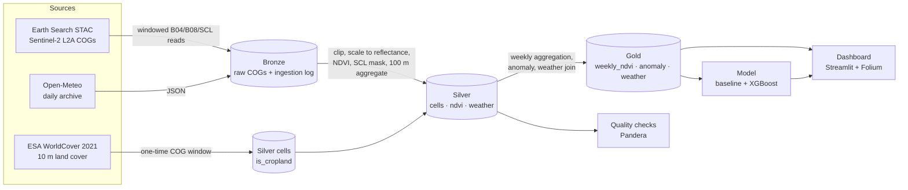

# Nile Delta Crop Monitoring — Project Context

## 1. The question

**How does crop health in a selected Nile Delta area change over a growing season, and how do heat
waves and rainfall affect it?**

We answer it with real satellite and weather data, not synthetic numbers.

## 2. Scope (locked in Phase 0)

| Item | Value |
| --- | --- |
| Area of interest | Central Nile Delta around Tanta / El-Mahalla El-Kubra (**AOI-A**) |
| Bounding box (WGS84) | west `30.86`, south `30.75`, east `31.36`, north `31.20` |
| Approx. size | ~47.7 km east–west × ~49.8 km north–south (**2 375 km²**) |
| Study seasons | **2019–2023**, same window **1 May – 30 Sep** each year |
| Focus season | **2023** (2019–2022 + leave-one-out 2023 form the baseline) |
| Imagery | Sentinel-2 L2A, bands B04 / B08 / SCL, windowed COG reads |
| Weather | Open-Meteo daily archive at the AOI centre |
| Storage | Local Parquet lake, queried with DuckDB |
| Grid | 100 m cells in EPSG:32636 (UTM 36N), ~238 000 cells |

### In scope

- Reproducible Bronze → Silver → Gold pipeline.
- Automated data-quality checks that fail loudly.
- A 5-day orchestrated schedule.
- A simple, honestly evaluated vegetation-stress model.
- A dashboard with a map, charts, predictions and pipeline health.

### Out of scope (for now)

- Full-scene downloads, multi-satellite fusion, cloud infrastructure (S3/MinIO), real-time streaming.
- Field-level segmentation; 100 m cells are neighbourhood indicators, not individual fields.
- AOIs outside the chosen bounding box.

---

## 3. Architecture

### 3.1 Data flow



`ingest → bronze → silver → quality → gold` is one Prefect flow (Phase 6), scheduled every 5 days.
Bronze is append-only and idempotent; Silver and Gold are rebuildable from Bronze.

### 3.2 Data sources — verified, not assumed

Both candidates were queried on 2026-11-10 with the real AOI and window.

| | **Earth Search v1** (recommended) | **Copernicus Data Space (CDSE)** |
| --- | --- | --- |
| STAC endpoint | `https://earth-search.aws.element84.com/v1` | `https://catalogue.dataspace.copernicus.eu/stac` |
| Search auth | none | none |
| Download auth | **none** — public HTTPS COGs | **account required**: OAuth token for OData, or S3 access/secret keys for `s3://eodata` |
| Asset format | Cloud-Optimized GeoTIFF (deflate, overviews) | **JPEG2000** in the SAFE product; no COG asset exists for `sentinel-2-l2a` (checked all 428 collections) |
| Windowed reads of B04/B08/SCL | **yes** — HTTP range request returned `206` | not practical: JP2 + no COG → a whole product zip (~0.8–1.2 GB) per date |
| L2A coverage, May–Sep 2019–2023 | 47–56 usable dates/season | 47–53 usable dates/season |
| Terms | free, full and open Sentinel data via AWS Registry of Open Data; free-to-use API with **no SLA** | free and open Copernicus data; registered account + terms of use |
| Tiles over AOI | `36RTV`, `36RUV` | `36RTV`, `36RUV` |

**Recommendation: Earth Search as primary.** It is the only one of the two that supports our actual
access pattern — reading ~23 MB of three bands instead of ~1 GB per date. CDSE is documented as the
fallback (same Sentinel-2 products, authoritative JP2), and its credentials stay optional in `.env`.

Trade-off accepted: we depend on a third-party public mirror without an SLA. Mitigation: retries with
exponential backoff, checksums in the ingestion log, and a CDSE code path behind the same interface.

### 3.3 Reflectance normalization — the docs and the data disagree

Sentinel-2 L2A processing baseline **04.00** (25 Jan 2022) introduced a **+1000 DN BOA offset**. A naive
implementation applies the STAC `raster:bands.offset = -0.1` for 2022+ scenes. **That is wrong for Earth
Search's `sentinel-2-l2a` collection**, and the real pixels prove it:

| Item | Baseline | `earthsearch:boa_offset_applied` | `raster:bands` offset | Valid DN < 1000 | Water median DN | NDVI > 1 if offset applied |
| --- | --- | --- | --- | --- | --- | --- |
| `S2A_36RTV_20190507_2_L2A` | 05.00 | `true` | −0.1 | 79.5 % | 768 / 736 (red/nir) | 90.5 % of vegetation pixels |
| `S2B_36RTV_20220715_0_L2A` | 04.00 | `true` | −0.1 | 69 % red, 82 % nir | 862 / 771 | — |
| `S2A_36RTV_20230715_0_L2A` | 05.09 | `true` | −0.1 | 76.1 % | 892 / 869 | 94.1 % of vegetation pixels |

A truly offset-baked product would have almost every valid DN ≥ 1000. Applying the advertised −0.1
pushes water reflectance negative and gives NDVI > 1 for ~90 % of cropland pixels — physically
impossible. This is a known, open metadata defect in this legacy collection
([Element84/earth-search#71](https://github.com/Element84/earth-search/issues/71)); the pixels are
already harmonized while `raster:bands` still advertises the offset.

**Normalization rule (all years, all tiles):**

```
reflectance = DN × 0.0001          # scale only; never subtract 0.1 for Earth Search COGs
ndvi        = (nir − red) / (nir + red)   # red, nir already in reflectance
```

- Do **not** use `raster:bands.offset` or `boa_offset_applied` from this collection.
- Do **not** clip negatives to 0 before NDVI; use the SCL mask instead.
- When the same acquisition has several processing baselines, keep the **highest baseline**: older
  baselines are often 20 m and not harmonized (e.g. `S2A_36RTV_20190507_1_L2A`, baseline 02.12, 5490×5490
  at 20 m), while baseline 05.00 is 10 m and harmonized.
- If we ever switch to CDSE JP2, the opposite applies: baseline ≥ 04.00 there **does** contain the
  +1000 offset, so subtract 1 000 DN.

**Phase 3 test requirements (added to the acceptance criteria):**

1. Unit: reflectance conversion on synthetic DN returns `DN / 10 000`, is never negative for `DN > 0`,
   and NDVI stays in `[-1, 1]`.
2. Integration: for one real item per baseline era (2019, 2021, 2022, 2023), assert ≥ 50 % of valid
   DN < 1000 (harmonized evidence) and ≥ 99.9 % of NDVI in `[-1, 1]`.
3. Dedupe: when two baselines exist for one `(tile, date)`, the highest baseline is selected and its
   asset is 10 m.

Earth Search's newer `sentinel-2-c1-l2a` collection has consistent metadata but **zero scenes for
2022 over this AOI** (verified), so it cannot replace the legacy collection for our 5-year baseline.

### 3.4 Storage layout and partitioning

```
data/bronze/
  sentinel2/tile=36RUV/year=2019/date=2019-05-04/B04.tif   # windowed COG, reflectance-ready DN
  sentinel2/tile=36RUV/year=2019/date=2019-05-04/B08.tif
  sentinel2/tile=36RUV/year=2019/date=2019-05-04/SCL.tif
  weather/year=2019/open_meteo_daily.json
  _logs/ingestion_log.parquet
data/silver/
  cells.parquet
  ndvi/year=2023/month=07/*.parquet
  weather/year=2023/weather.parquet
data/gold/
  weekly_ndvi/year=2023/*.parquet
  ndvi_anomaly/year=2023/*.parquet
  weekly_weather/year=2023/weekly_weather.parquet
```

- Bronze is raw and append-only; a re-run skips assets whose `asset_key` + checksum already exist.
- Silver/Gold are **overwritten** per `(year, month)` / `(year)` for idempotency — rerunning a date
  replaces its rows instead of appending duplicates.
- Silver partitions follow the requirement (year/month). Gold is year-partitioned; weekly tables are
  small and date-filtered.

### 3.5 Grid design

- **100 m cells, EPSG:32636**, origin snapped to the AOI's south-west corner in UTM. 478 × 498 ≈
  **238 000 cells**.
- NDVI is computed at native **10 m**, then mean-aggregated to 100 m; the SCL mask (native 20 m) is
  upsampled to 10 m for masking.
- Why not 10 m/20 m: 20 m → 6.25 M cells per date, ~1.5 B rows over 5 years — too heavy for a laptop.
  Why not 250 m/1 km: a 250 m cell is 6.25 ha and a 1 km cell 100 ha, while typical Delta holdings are
  0.1–1 ha; both smear field-scale stress into noise.
- **Cost accepted:** a 100 m cell (~1 ha) still mixes several small fields. We report a neighbourhood
  health signal, not field-level diagnosis; this is stated again in the dashboard and README.

Row estimates (≈293 acquisition dates across 5 seasons at the 40 % cloud filter):

| Layer | Rows | Est. size |
| --- | --- | --- |
| Bronze | ~586 tile-dates × 3 bands | **~14 GB** (12–16 GB) |
| Silver `ndvi` | 238 k × 293 ≈ **70 M** | ~2–3 GB Parquet |
| Silver `cells` | 238 k | < 20 MB |
| Silver `weather` | 755 days | < 1 MB |
| Gold weekly (all cells) | 238 k × 110 weeks ≈ **26 M** | ~1–2 GB |
| Gold weekly (cropland only) | ~193 k × 110 ≈ **21 M** | ~0.8–1.5 GB |

The machine has **443 GB free** (see the Phase 1 report), so disk is not a constraint. Time is: at the
measured 1.5–2.4 MB/s from this network, the ~14 GB download takes roughly **1.6–2.6 hours**.

### 3.6 Cropland mask

Source: **ESA WorldCover 10 m 2021 v200**, class `40` (cropland), tile `N30E030`, CC BY 4.0, served as
a COG from `esa-worldcover.s3.eu-central-1.amazonaws.com` (verified `200 OK`, 47.4 MB).

Measured over the AOI:

- **78.5 %** of 10 m pixels are cropland; built-up 15.0 %, wetland 1.9 %, trees 2.6 %, water 0.6 %.
- At 100 m, **81.0 %** of cells have ≥ 50 % cropland pixels → **~193 000 cropland cells**, ~45 000
  non-cropland.
- A cell is `is_cropland = true` when `cropland_pct ≥ 50`; `cropland_pct` and `worldcover_class` are
  kept so the threshold can be changed without re-reading the COG.
- Filtering to cropland removes ~19 % of cells, mostly urban fringes and canals, and prevents built-up
  pixels from diluting NDVI averages. Gold aggregates use cropland cells only; Silver keeps all cells
  with the flag so the effect is auditable.

Limitations: WorldCover is a **2021 static snapshot**, so land-use change after 2021 and mixed 100 m
cells introduce classification error. `is_cropland` is nullable when the mask has no coverage.

### 3.7 Cloud filter and weekly sampling

Scene-level `eo:cloud_cover` is tile-wide, not AOI-wide, so a "cloudy" scene can still be clear over
Tanta. Verified unique acquisition dates per season:

| Season | cloud < 20 % | cloud < 40 % | Gain |
| --- | --- | --- | --- |
| 2019 | 55 | 59 | +4 |
| 2020 | 55 | 59 | +4 |
| 2021 | 56 | 60 | +4 |
| 2022 | 51 | 59 | +8 |
| 2023 | 47 | 56 | +9 |

**Recommendation: 40 % scene filter.** In 2023 it lifts weeks with ≥ 2 usable acquisitions from 17 to
19 of 22, and 2022 from 17 to 20; per-pixel SCL masking plus the masked-percentage checks remove the
cloudy pixels that the looser filter lets in. The 20 % filter is kept as a config option.

**Weekly rule (no silent fills):**

- Week = ISO week, Monday–Sunday. A `(cell, week)` value is produced only if the cell has **≥ 2
  distinct acquisition dates with at least one unmasked 10 m pixel** in that week, and the weekly mean
  `masked_pct ≤ 50 %`.
- Otherwise the row is still written with `ndvi_mean = NULL`, `n_obs` set, and
  `status = 'insufficient_observations'` or `'too_cloudy'`. Nothing is interpolated.
- Anomaly requires a non-null current-week value **and** a baseline mean from **≥ 3 baseline years**;
  otherwise `anomaly = NULL` with `status = 'no_baseline'`.
- Weather is always complete (Open-Meteo reanalysis), so missing weather is a hard error, not a null.

### 3.8 Schemas

All timestamps are UTC. `date` is the Sentinel-2 acquisition date, not the ingestion date.

#### Bronze — `ingestion_log.parquet` (PK: `asset_key`)

| Column | Type | Notes |
| --- | --- | --- |
| `asset_key` | string | `{item_id}:{band}` for imagery, `weather:{year}` for weather |
| `ingested_at_utc` | timestamp[us, UTC] | run timestamp |
| `source` | string | `earth-search` \| `open-meteo` |
| `collection` | string | `sentinel-2-l2a` \| `open-meteo-archive` |
| `item_id` | string, null | STAC item id |
| `tile` | string, null | `36RTV` / `36RUV` |
| `acquired_at` | timestamp[us, UTC], null | scene datetime |
| `band` | string, null | `B04` \| `B08` \| `SCL` |
| `path` | string | local relative path |
| `bytes` | int64 | file size |
| `sha256` | string, null | checksum when computed |
| `cloud_cover` | float32, null | `eo:cloud_cover` |
| `processing_baseline` | string, null | e.g. `05.09` |
| `boa_offset_applied` | boolean, null | recorded for audit only — **not used** for conversion |
| `stac_href` | string, null | source asset URL |

Raw Bronze files are COGs per `(tile, year, date, band)`; no Parquet.

#### Silver — `cells.parquet` (PK: `cell_id`)

| Column | Type | Notes |
| --- | --- | --- |
| `cell_id` | int32 | `cell_row * 1000 + cell_col`; stable within the AOI |
| `cell_row` | uint16 | 0-based row in the 100 m grid |
| `cell_col` | uint16 | 0-based column |
| `centroid_lon` | float64 | WGS84 centroid |
| `centroid_lat` | float64 | WGS84 centroid |
| `cropland_pct` | float32, null | % of 10 m cropland pixels in the cell |
| `is_cropland` | boolean, null | `cropland_pct ≥ 50`; null if mask unavailable |
| `worldcover_class` | uint8, null | majority WorldCover class |

#### Silver — `ndvi/year=/month=/` (PK: `(cell_id, date)`)

| Column | Type | Notes |
| --- | --- | --- |
| `cell_id` | int32 | FK → `cells` |
| `date` | date | acquisition date |
| `ndvi` | float32, null | mean of unmasked 10 m NDVI; null if no valid pixel |
| `valid_pixels` | uint16 | unmasked 10 m pixels (0–100) |
| `total_pixels` | uint16 | 100 by construction |
| `masked_pct` | float32 | 100 × (1 − valid/total) |

No weather columns here: weather lives in its own table and is joined in Gold or at query time — this
keeps Silver rows narrow and avoids repeating ~5 values per row ~70 M times.

#### Silver — `weather/year=/` (PK: `date`)

| Column | Type | Notes |
| --- | --- | --- |
| `date` | date | local day (Africa/Cairo) |
| `temp_max_c` | float32 | °C |
| `temp_min_c` | float32 | °C |
| `temp_mean_c` | float32 | °C |
| `precip_mm` | float32 | mm/day |
| `solar_mj_m2` | float32 | shortwave radiation sum, MJ/m²/day |

#### Gold — `weekly_ndvi/year=/` (PK: `(cell_id, week_start)`)

| Column | Type | Notes |
| --- | --- | --- |
| `cell_id` | int32 | |
| `week_start` | date | Monday |
| `ndvi_mean` | float32, null | mean of valid observations |
| `ndvi_std` | float32, null | observation spread within week |
| `n_obs` | uint8 | distinct valid acquisition dates |
| `masked_pct_mean` | float32, null | mean masked share across observations |
| `status` | string | `ok` \| `insufficient_observations` \| `too_cloudy` |

#### Gold — `ndvi_anomaly/year=/` (PK: `(cell_id, week_start)`)

| Column | Type | Notes |
| --- | --- | --- |
| `cell_id` | int32 | |
| `week_start` | date | |
| `ndvi_mean` | float32, null | current week |
| `baseline_mean` | float32, null | same ISO week in baseline years |
| `baseline_std` | float32, null | |
| `anomaly` | float32, null | `ndvi_mean − baseline_mean` |
| `zscore` | float32, null | `anomaly / baseline_std` (null if std = 0) |
| `n_baseline_years` | uint8 | ≥ 3 required |
| `status` | string | `ok` \| `no_baseline` \| `insufficient_observations` |

#### Gold — `weekly_weather/year=/` (PK: `week_start`)

| Column | Type | Notes |
| --- | --- | --- |
| `week_start` | date | |
| `temp_max_mean_c` | float32 | mean of daily maxima |
| `temp_max_max_c` | float32 | hottest day of the week |
| `temp_min_mean_c` | float32 | |
| `precip_sum_mm` | float32 | weekly total |
| `solar_sum_mj_m2` | float32 | weekly total |
| `heatwave_days` | uint8 | days above the documented threshold (defined in Phase 5) |

### 3.9 Tool choices (one line each)

| Tool | Why |
| --- | --- |
| `pystac-client` | Standard STAC search/pagination, works against Earth Search and CDSE |
| `odc-stac` + `rioxarray` | Windowed COG reads into labelled arrays without downloading scenes |
| `rasterio` / GDAL | CRS reprojection, resampling to the 100 m grid, SCL masking |
| `numpy` | Vectorised NDVI and aggregation |
| `pyarrow` + Parquet | Columnar, compressed, partitioned storage |
| `duckdb` | Sub-second SQL over Parquet with no server |
| `pandera` | Schema and value checks expressed as code and run as a pipeline gate |
| `prefect` 3 | Python-native orchestration; lighter locally than Airflow, same retry/backoff model |
| `pydantic-settings` + `python-dotenv` | Typed config and `.env` loading, no hardcoded secrets |
| `pytest` | Phase-level tests |
| `streamlit` + `folium` | Fast interactive map/dashboard demo |
| `scikit-learn` + `xgboost` | Naive baseline and gradient-boosted model |
| `uv` | Fast, reproducible environments (Python 3.12) |

### 3.10 Quality gates (detailed in Phase 4)

Critical checks fail the run: NDVI ∈ [−1, 1]; `masked_pct` below the configured cap; duplicate
`(cell_id, date)` keys; stable schema; daily weather completeness; weekly `n_obs` consistency. Gaps
longer than 10 days are **flagged, never filled**. Each run writes a JSON + Markdown quality report.

### 3.11 Risks

| Risk | Likelihood | Impact | Mitigation |
| --- | --- | --- | --- |
| Cloud cover leaves whole weeks empty | Medium | Medium | 40 % scene filter + SCL masking; week 20/32 can still be empty — emit NULL + status, report coverage per week |
| Duplicate / overlapping acquisitions | High | High | Dedupe on `(tile, date)` keeping the highest processing baseline; never append duplicates (idempotent writer) |
| SCL mask quality (thin cirrus, shadows, 20 m upsampled) | Medium | High | Mask classes 0/1/3/8/9/10/11; track `masked_pct`; fail/flag weeks above 50 %; compare against NDVI outliers |
| BOA offset metadata is wrong in Earth Search | High (confirmed) | High | Scale-only normalization + Phase 3 tests + checksummed Bronze; CDSE JP2 fallback subtracts the offset |
| Data volume / runtime | Low | Medium | ~14 GB Bronze, 443 GB free; windowed reads cut bytes ~50×; download ~2 h |
| Earth Search has no SLA / rate limits | Medium | High | Retries with exponential backoff, bounded concurrency, ingestion log resume, CDSE fallback |
| 100 m cells mix fields | High | Medium | Documented as neighbourhood signal; `cropland_pct` exposed for filtering; 20 m mode is future work |
| WorldCover 2021 is static | Medium | Medium | Keep class + percentage so thresholds can change; note in dashboard legend |
| Weekly sampling drops sparse weeks | Medium | Medium | Explicit `status`, never interpolated; coverage metrics in quality report |
| **Leakage: baseline used as a model feature** | Medium | **High** | Leave-one-year-out baseline is for **exploratory Gold only**. In Phase 7, any baseline/anomaly feature must be computed from **training years only** (expanding window per split year). Violating this gives inflated metrics |
| "Stress" target is ambiguous | High | High | Define precisely in Phase 7 (e.g. NDVI drop ≥ 0.1 vs previous 2 weeks, cropland only); harvest/senescence confounds documented in the model card |

### 3.12 Leakage rule (model phase)

The leave-one-year-out baseline in Gold is valid for **descriptive analysis** ("how does 2023 compare
to other years?"). It is **not** valid as a feature for the Phase 7 model: using the test year in a
baseline leaks the future. For modelling, every baseline/anomaly feature is recomputed per split using
only the training years before that split (expanding window, always time-ordered). This rule is a
release blocker for Phase 7 and is repeated in the model card.

---

## 4. Repository layout

```
.
├── PROJECT.md           # question, scope, architecture, decisions log
├── PROGRESS.md          # phase checklist and notes
├── README.md            # short landing page until Phase 9
├── config/aoi.yaml      # AOI, seasons, grid, quality thresholds
├── data/                # local lake: bronze | silver | gold (gitignored)
├── dags/                # orchestration (Phase 6)
├── docs/                # reports, model card, screenshots
├── src/delta_crops/
│   ├── ingestion/       # Phase 2: Earth Search + Open-Meteo → Bronze
│   ├── transform/       # Phase 3: Bronze → Silver, Phase 5: Gold
│   ├── quality/         # Phase 4: data-quality checks
│   ├── features/        # Phase 7: modelling features
│   ├── models/          # Phase 7: baseline + XGBoost
│   └── dashboard/       # Phase 8: Streamlit app
└── tests/               # pytest suite, one file per concern
```

`src/delta_crops/` is a single installed package so imports are unambiguous and `pip install -e .`
works from any working directory.

## 5. Environment setup

Requires Python 3.10–3.13 (3.12 recommended; the geo stack has no 3.14 wheels yet).

```bash
uv venv --python 3.12 .venv
source .venv/bin/activate
uv pip install -e ".[dev]"
cp .env.example .env      # optional: only needed if we fall back to CDSE
pytest -q
```

## 6. Decisions log

| ID | Date | Decision | Why |
| --- | --- | --- | --- |
| D-001 | 2026-11-10 | Project root is this repository, not a nested `delta-crops/` folder | Avoids a redundant directory level |
| D-002 | 2026-11-10 | AOI-A with south edge at `30.75` | ~50×50 km and Tanta fully inside |
| D-003 | 2026-11-10 | First season is summer 2023 (May–Sep) | Clear skies and peak heat |
| D-004 | 2026-11-10 | Python 3.10–3.13, 3.12 recommended | Raster stack lacks 3.14 wheels |
| D-005 | 2026-11-10 | Package under `src/delta_crops/` | Clean editable install |
| D-006 | 2026-11-10 | Only used libraries are declared per phase | No scope creep |
| D-007 | 2026-11-10 | **Earth Search is the primary imagery source**, CDSE is the fallback | Only Earth Search supports windowed COG reads without auth; CDSE JP2 means ~1 GB/date |
| D-008 | 2026-11-10 | Baseline seasons 2019–2023, same May–Sep window | 2019–2023 availability verified; 5 seasons give a usable anomaly baseline |
| D-009 | 2026-11-10 | Reflectance = `DN × 0.0001`; ignore Earth Search `raster:bands.offset` | Real pixels show data already harmonized; advertised −0.1 produces negative reflectance and NDVI > 1 (issue #71) |
| D-010 | 2026-11-10 | 100 m grid in EPSG:32636 | Balances field size against 5-year row counts |
| D-011 | 2026-11-10 | Weather in its own Silver table, joined in Gold | Avoids repeating 5 weather values in ~70 M NDVI rows |
| D-012 | 2026-11-10 | Cropland flag from ESA WorldCover 10 m 2021 (CC BY 4.0) | Free, 10 m, covers AOI; removes urban/canal pixels from averages |
| D-013 | 2026-11-10 | 40 % scene-level cloud filter + SCL per-pixel mask | Adds 4–9 dates/season vs 20 %; SCL handles residual cloud |
| D-014 | 2026-11-10 | Weekly value requires ≥ 2 valid observations; otherwise NULL + status | Honest gaps beat interpolated fake signal |
| D-015 | 2026-11-10 | Leave-one-year-out baseline is exploratory only; model features use training years only | Prevents temporal leakage in Phase 7 |
| D-016 | 2026-11-10 | Prefect 3 for orchestration | Lighter than Airflow locally; same retry/backoff semantics |

## 7. Open questions for later phases

- Exact heat-wave definition for `heatwave_days` (Phase 5).
- Exact stress threshold and forecast horizon (Phase 7).
- Whether a 20 m "hotspot" Gold table is worth the extra volume (propose only if needed).
