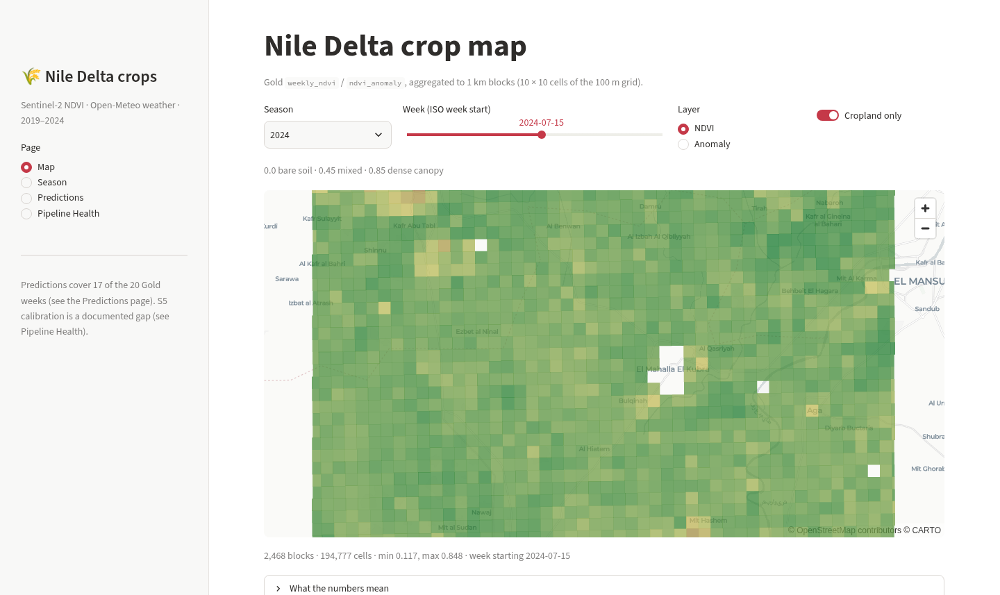
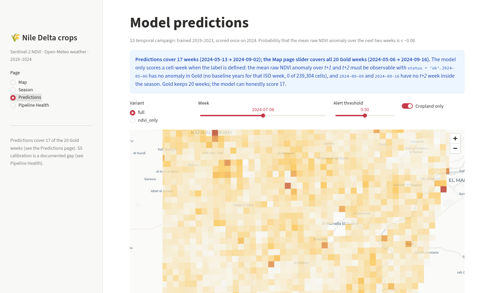
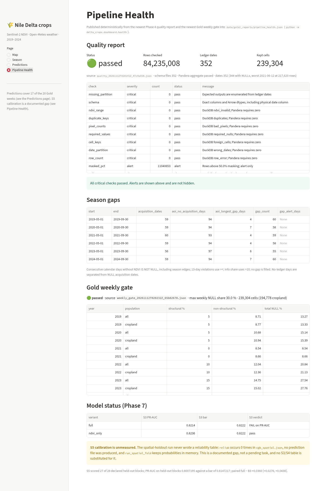
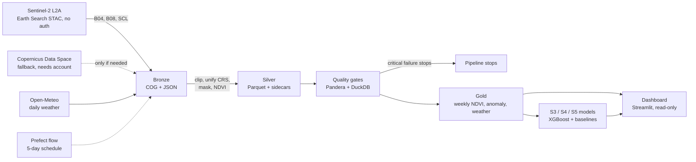

# Nile Delta Crop Monitoring

**How does crop health in a 50 × 50 km area of the central Nile Delta change over a growing season,
and how do heatwaves and rainfall affect it?**

An end-to-end satellite pipeline that answers that question with real data: Sentinel-2 L2A surface
reflectance and Open-Meteo weather for six seasons (2019–2024) → a Bronze / Silver / Gold Parquet
lake → automated quality gates → a stress model evaluated by time and by space → an interactive
dashboard and a documented, honest result.

**Headline result:** vegetation stress *is* predictable from NDVI history, but it is a near-miss
against the pre-registered bar, and **adding weather does not help** — the NDVI-only variant beats
the full model in every campaign. All three campaigns miss the PR-AUC bar on the headline model,
by 0.0008 (S3), 0.0014 (S4) and 0.0140 (S5). P@R.5 and Brier pass. No heatwave effect is claimed.

[Question and scope](PROJECT.md) · [Model card](docs/model-card.md) · [Limitations](docs/limitations.md) ·
[Phase history](PROGRESS.md) · [Demo script](docs/demo-2min.md)

## Contents

1. [Results](#results)
2. [Screenshots](#screenshots)
3. [Architecture](#architecture)
4. [Design decisions and trade-offs](#design-decisions-and-trade-offs)
5. [Data sources and attribution](#data-sources-and-attribution)
6. [Quick start](#quick-start)
7. [Get a data lake](#get-a-data-lake)
8. [Run the dashboard](#run-the-dashboard)
9. [Orchestration and Docker Compose](#orchestration-and-docker-compose)
10. [Limitations](#limitations)
11. [Future work](#future-work)
12. [Repository layout](#repository-layout)
13. [Tests](#tests)
14. [Licence](#licence)

## Results

The target is frozen in [`docs/phase7-preregistration.md`](docs/phase7-preregistration.md): for a
cell-week using only data up to week `t`, is the mean **raw** NDVI anomaly over `t+1` and `t+2`
≤ −0.08? The bar is the B3 logistic baseline plus 0.05 PR-AUC, strictly better P@R.5 and strictly
lower Brier, derived per campaign from that campaign's own B3.

The table below is **generated from the artifacts** by
[`scripts/readme_results.py`](scripts/readme_results.py) and checked by the test suite, so it cannot
drift from `xgb_temporal.json`, `xgb_loso.json` and `xgb_spatial.json`:

<!-- results:start -->
| Campaign | Variant | PR-AUC | PR-AUC bar | P@R.5 | P@R.5 bar | Brier | Brier bar | Verdict |
| --- | --- | --- | --- | --- | --- | --- | --- | --- |
| S3 temporal (2024) | `full` | 0.8213705 | 0.8222002 | 0.8713148 | 0.8145373 | 0.0936884 | 0.1050482 | fail PR-AUC only |
| S3 temporal (2024) | `ndvi_only` | 0.8235561 | 0.8222002 | 0.8740272 | 0.8145373 | 0.0924263 | 0.1050482 | **pass** |
| S4 leave-one-season-out | `full` | 0.8191470 | 0.8205095 | 0.8754861 | 0.8187709 | 0.0835801 | 0.0947832 | fail PR-AUC only |
| S4 leave-one-season-out | `ndvi_only` | 0.8235976 | 0.8205095 | 0.8812944 | 0.8187709 | 0.0824871 | 0.0947832 | **pass** |
| S5 held-out 5 km blocks | `full` | 0.8007195 | 0.8147217 | 0.8436102 | 0.8070753 | 0.0960768 | 0.1036731 | fail PR-AUC only |
| S5 held-out 5 km blocks | `ndvi_only` | 0.8042603 | 0.8147217 | 0.8470021 | 0.8070753 | 0.0942075 | 0.1036731 | fail PR-AUC only |

Populations: S3 scores 2,449,220 cropland cell-weeks (614,324 positives) once on 2024; S4 averages 6 held-out seasons; S5 scores 27 of 28 declared held-out 5 km blocks. S3 and S4 PR-AUC bars are the campaign's B3 + 0.05; P@R.5 and Brier must be strictly better.
<!-- results:end -->

What this means, in words:

- **The headline model (`full`, with weather) misses PR-AUC in all three campaigns** and passes
  P@R.5 and Brier everywhere. That is a near-miss, not a success, and it is reported as one.
- **`ndvi_only` beats `full` in all three campaigns**, and passes all three conditions in S3 and S4.
  So the weather features add no measurable skill on top of NDVI history in this dataset — the
  project's second question ("how do heatwaves and rainfall affect it?") is answered
  **descriptively**, not with a demonstrated causal or predictive effect.
- **S5 is the honest generalisation check**: train on 2019–2023 minus 28 held-out 5 km blocks, score
  the held-out blocks in 2024. It fails PR-AUC by 0.0140, the largest gap, on new locations with
  known history (not a cold start).
- Full numbers, calibration tables, sanity controls and caveats: [`docs/model-card.md`](docs/model-card.md).

## Screenshots

| Map — weekly NDVI, 2024-07-15, cropland (2,468 blocks) | Predictions — S3 probability, week of 2024-07-08 |
| --- | --- |
|  |  |



All three were captured from the running app at 1440 px with its default week selection; the weeks,
counts and statuses are the app's own. The health capture is full-height, so the S5 gap at the
bottom is the same warning the page shows. No image is a mock-up.

## Architecture



| Layer | What it holds | Rows / size | Partitioning |
| --- | --- | --- | --- |
| Bronze | 2,027 downloaded assets: Sentinel-2 COGs (B04, B08, SCL) and weather JSON, plus a ledger | 30.7 GB (25.81 GB for 2019–2023 + 4.9 GB for 2024) | `bronze/<product>/year=/month=/` |
| Silver | 352 dates of per-cell NDVI, masked share, status, orbit mix; `cells.parquet` (239,304 cells) | 84,235,008 quality-checked rows | `silver/ndvi/year=/month=/` |
| Gold | `weekly_ndvi`, `ndvi_anomaly`, `weekly_weather` | 28,716,480 rows per cell table, 120 weather rows | `gold/<table>/year=/` |
| Artifacts | Phase 7 metrics, dataset, the frozen 2024 prediction dump | 626 MB dataset, 29.6 MB predictions | `artifacts/phase7|8/` |

The 100 m grid, the cropland mask, the weekly `ok` rule and the anomaly construction are documented
in [`PROJECT.md`](PROJECT.md) §3. Two implementation details worth knowing:

- **NDVI is computed from raw DN with the BOA offset applied per era** (the 2019–2021 products are
  offsets different from 2022+); the reasoning and the measured evidence are in PROJECT §3.3.
- **The anomaly is a raw difference, not a z-score.** With 3–4 baseline years per cell-week the
  z-score has unusable tails (p1 = −8.2, p99 = +7.5), so it is never presented as stress detection
  (D-046).

## Design decisions and trade-offs

| Decision | Why | What it costs |
| --- | --- | --- |
| DuckDB, not Spark | 84M rows fit on one laptop; no cluster to operate; Parquet scans answer the gold queries in ~1 s | No distributed scale; a bigger AOI or 10 m analysis would force a rethink |
| Local Parquet lake, not object storage | Reproducible, inspectable, cheap; MinIO was optional and skipped | Not shareable; `data/` is gitignored and must be rebuilt |
| 100 m analysis grid | 10 m is noisy and 60× the volume; 100 m matches field blocks and keeps the dashboard light | Sub-field variability is averaged away; 1 km is used only for display |
| Weekly composites, `status='ok'` only | Sentinel-2 revisit + cloud cover make daily NDVI unusable; the rule (≥2 observations, ≤50 % masked) was fixed before results | 5–15 % structural NULLs at season edges; no interpolation anywhere |
| Raw anomaly over z-score | Baseline std from 3–4 values has heavy tails (D-046) | Less familiar than a z-score; threshold −0.08 is physical NDVI |
| Leave-one-season-out baseline | A season must never enter its own climatology (D-015) | Only 3–5 baseline years, so anomalies are noisy |
| Time split (S3) and spatial holdout (S5), never random | Random splits leak the same season into train and test | Fewer evaluation seasons; 2024 is a single, extreme test year |
| Frozen bars derived per campaign | Comparing campaigns against one borrowed bar hides what each one tests (D-049) | All three fail; the result is not massaged |
| XGBoost, not deep learning | Tabular, 15M rows, interpretable gain, CPU-only | No sequence model; lag features are hand-built |
| One persistence step for predictions, behind a 1e-9 gate | Phase 7 saved metrics, not rows; the dashboard needs rows without inventing a new model (D-052) | 561 s and 8.9 GB RAM to regenerate; the file is gitignored |
| Health published into Gold, not recomputed | The dashboard may read only Gold, and re-running checks would duplicate Phase 4 (D-053) | One extra JSON to keep in sync; publishing is a step in the run |
| 1 km display blocks | 239,304 polygons per week is unreadable and slow | Block edges are centroid envelopes, not true footprints |
| Read-only dashboard enforced by a SQL guard | `duckdb.read_only` applies to a database file, not Parquet | A code-level guard plus an mtime test, not a database permission |

The full log is [PROJECT.md §6](PROJECT.md) (D-001…D-058).

## Data sources and attribution

This project uses third-party data. The licences below are the ones that apply to the data, not to
this repository's code.

| Source | What we use | Licence and required credit |
| --- | --- | --- |
| **ESA WorldCover 10 m 2021 v200** | Cropland mask (`worldcover_class`, `is_cropland`) aggregated from 10 m to the 100 m grid | **CC BY 4.0** — © ESA WorldCover project 2021 / Contains modified Copernicus Sentinel data (2021) processed by ESA WorldCover consortium. Product: <https://esa-worldcover.org/en/data-access>. Licence: <https://creativecommons.org/licenses/by/4.0/> |
| **Open-Meteo** | Daily maximum/minimum temperature, precipitation, shortwave radiation for the AOI centre | **“Weather data by Open-Meteo.com”**, licensed **CC BY 4.0** (<https://open-meteo.com/>, <https://creativecommons.org/licenses/by/4.0/>) |
| **Sentinel-2 L2A** via Earth Search (Element 84, AWS Open Data) | B04, B08 and SCL bands; STAC search; anonymous COG reads | Copernicus Sentinel data, processed by ESA. Earth Search: <https://earth-search.aws.element84.com/v1>. AWS Open Data terms apply to the hosting |
| **Copernicus Data Space Ecosystem** (documented fallback) | The same products if Earth Search is unavailable | Copernicus Sentinel data; a free account is required. Credentials go in `.env`, never in code |
| **OpenStreetMap / administrative boundaries** | Not used | — |

No third-party data is redistributed in this repository: `data/` is gitignored and every table is
rebuilt by the pipeline. If you publish results derived from these sources, keep the credits above.

## Quick start

Requires Python 3.10–3.13 (3.12 recommended) and [`uv`](https://docs.astral.sh/uv/). No credentials
are needed for the default path (Earth Search and Open-Meteo are open).

```bash
git clone <this-repository> delta-crops
cd delta-crops
uv venv --python 3.12 .venv
source .venv/bin/activate
uv pip install -e ".[dev,dashboard]"
pytest -q
```

Expected: the suite passes with no network and no data lake (tests that need the real lake skip with
a reason). The prediction-dump and dashboard tests skip on a fresh clone — see
[Run the dashboard](#run-the-dashboard).

```bash
cp .env.example .env   # optional: only for the Copernicus Data Space fallback
```

Fast loop while developing (skips the Prefect flow and slow regression tests):

```bash
pytest -q -m "not flow and not slow"
```

## Get a data lake

`data/` is not in git (30.7 GB of imagery). You need a lake before the CLIs and the dashboard can do
real work. Two paths:

### A. You already have a lake

Point the tools at it; nothing is copied:

```bash
export DELTA_CROPS_DATA=/path/to/data
python -m delta_crops.verify --year 2024      # sanity check on Bronze
```

### B. Rebuild from the sources (network, several hours, ~31 GB)

The pipeline is idempotent: every step skips work already done and can be re-run safely.

```bash
# 1. Bronze: STAC search + band download + daily weather (2019-2024 in config/aoi.yaml)
python -m delta_crops.ingest --config config/aoi.yaml --data-dir data
python -m delta_crops.verify --config config/aoi.yaml --data-dir data

# 2. Silver: clip, unify CRS, cloud-mask, NDVI, one file per acquisition date
python -m delta_crops.transform.cli --config config/aoi.yaml --data-dir data build

# 3. Quality gate: Pandera schema + DuckDB aggregates; exits non-zero on a critical failure
python -m delta_crops.quality.cli --config config/aoi.yaml --data-dir data

# 4. Gold: weather -> weekly -> anomaly (this order matters)
python -m delta_crops.gold.cli --config config/aoi.yaml --data-dir data weather
python -m delta_crops.gold.cli --config config/aoi.yaml --data-dir data weekly
python -m delta_crops.gold.cli --config config/aoi.yaml --data-dir data anomaly
```

Measured cost, so you can plan: Bronze for 2019–2023 is 1,722 assets / 25.81 GB; season 2024 alone
was 305 assets in 4,451.5 s. The 2024 build and its checks are recorded in
[`docs/adding-season-2024.md`](docs/adding-season-2024.md). Silver 2024: 59 dates in 83.8 s.

> **Disk warning:** the six-season lake is ~31 GB of Bronze plus ~22 GB of Silver, and the Phase 7
> dataset is 626 MB. Start with one season if you are exploring.

The Phase 7 artifacts (metrics, dataset, prediction dump) are also gitignored. Their commands are in
[the model card](docs/model-card.md); the dashboard needs only the **prediction dump**:

```bash
python -m delta_crops.models.predictions   # 561.2 s, 8,912 MB peak RSS, writes 29.6 MB
```

## Run the dashboard

One command, from the repository root, after the lake and the prediction dump exist:

```bash
python -m delta_crops.dashboard.health   # publish data/gold/_reports/pipeline_health.json (once per refresh)
delta-crops-dashboard                    # http://localhost:8501
```

The dashboard reads `data/gold/**`, the health summary and `artifacts/phase7|8/**`; it never writes to
the lake (a SELECT-only guard and a test that snapshots file mtimes enforce it).

Paths can be overridden:

| Variable | Default | Meaning |
| --- | --- | --- |
| `DELTA_CROPS_DATA` | `data` | Lake root (`gold/`, `silver/cells.parquet`) |
| `DELTA_CROPS_PREDICTIONS` | `artifacts/phase8/predictions/temporal_2024.parquet` | Frozen S3 dump |
| `DELTA_CROPS_ARTIFACTS` | `artifacts/phase7` | Metric JSONs |

Pages: **Map** (weekly NDVI or anomaly on 1 km blocks, 20 Gold weeks), **Season** (NDVI vs Tmax,
heatwave and rainfall bars), **Predictions** (17 scored weeks, scoreboard, calibration) and
**Pipeline Health** (quality checks, season gaps, Gold gate, model status, the S5 gap).

> **Predictions cover 17 of the 20 Gold weeks.** The target needs `t+1` and `t+2` inside the season:
> `2024-09-09` and `2024-09-16` have no `t+2`, and `2024-05-06` has no anomaly (0 of 239,304 cells —
> no baseline years for that ISO week). Nothing is padded; the page says so.

## Orchestration and Docker Compose

The pipeline runs as a Prefect flow: one DAG (ingest → Silver → quality → Gold), every 5 days, with
retries and a log-based failure alert, and every task idempotent.

### Docker Compose (one command)

```bash
mkdir -p .prefect
HOST_UID=1000 HOST_GID=1000 docker compose up -d --build     # Prefect server + orchestrator
docker compose ps
```

Add the dashboard with the optional profile (publishes health first, then serves on
`127.0.0.1:8501`):

```bash
HOST_UID=1000 HOST_GID=1000 docker compose --profile dashboard up -d --build
```

The dashboard service mounts `data/` and `artifacts/` **read-only**; a one-shot `health-publish`
service (the only writer, touching one JSON) runs before it. The pipeline image
(`delta-crops:local`) does not contain Streamlit; the dashboard image is a separate build stage
(`delta-crops:dashboard`). Build with the literal `1000` ids: deriving them from `id -g` breaks after
`newgrp docker`, because the container user then stops owning `data/`.

What is proven and what is not:

| Claim | Status |
| --- | --- |
| Flow wiring, retries, failure logging, container suite (`133 passed, 6 skipped, 12 deselected`), integration test in the image (`1 passed`) | Measured (Phase 6b) |
| Idle memory: orchestrator 104 MiB, server 234.5 MiB | Measured, idle only — not under load |
| A manual trigger runs the full DAG | Measured with a fixture config, not on the real lake |
| The scheduled flow has run end-to-end on real data | **Not proven** — the real Silver/Gold were built by hand |
| Two container runs never overlap | **Not proven** — `global_limit=1` is set, but `no_op` finishes in ~0.3 s, so the attempt was inconclusive |
| Healthchecks prove the API answers and the deployment is unpaused | Measured; this is not a heartbeat |

Details: [`docs/phase6-orchestration.md`](docs/phase6-orchestration.md),
[`docs/phase6b-docker.md`](docs/phase6b-docker.md). Never run the default config against an empty
`--data-dir`: it starts a real multi-year ingest.

Without Docker:

```bash
python -m delta_crops.orchestration                     # one run of the flow
python -m delta_crops.orchestration --reprocess-year 2021
```

## Limitations

Every item below is documented with its measured evidence, why it is not fixed, and what it means
for the claims, in [`docs/limitations.md`](docs/limitations.md).

| Limitation | Effect on the claims |
| --- | --- |
| **36.70 % of invalid in-AOI pixels are DN = 0 on 2021-07-10** (cloud/shadow explains 62.12 %; other masked classes 1.19 %); cause **not established** | One date, no global DN floor; treated as a local artefact, not corrected |
| **Scheduled flow never ran end-to-end on real data** | Scheduling is verified wiring, not observed production behaviour |
| **Container concurrency unproven** | `global_limit=1` is configured; non-overlap under load was not observed |
| **`gold_regression.py` was not re-run after 2024** — re-run in Phase 9, result in the limitations page | 2019–2023 weekly/weather tables matched the snapshot before; anomaly drift from the six-year leave-one-out pool is expected, not a bug |
| **S5 calibration unmeasured** — no S5 prediction file and no reliability block | The spatial model's probabilities are uncalibrated; only S3 is calibrated |
| **Weather adds no skill** — `ndvi_only` beats `full` in S3, S4 and S5 | No predictive claim about heatwaves or rainfall; descriptive only |
| **Small baseline sample** — 3–4 years per cell-week; 2024 is one test season | Anomalies are noisy; S3 is a single-year test |
| **2024 `week_index = 2` extrapolation** — no training season has that week index | Those predictions are extrapolation; the lag-2 weather feature is missing for them |
| **600-round cap** binds in two S4 folds and nearly in S5 | A different cap could change results; not raised post hoc |
| **One AOI, one crop region** — central Nile Delta, ~50 × 50 km | Not generalisable to other regions or to field-level decisions |
| **DN > 0 Silver floor** — `DN = 0` is treated as invalid, not reflectance | Local NDVI can be biased where the floor is common; measured, retained (D-042) |
| **1 km display blocks are centroid envelopes** | Edges are approximate; values are means over `ok` cells |
| **Prediction dump is gitignored** | A clone must rerun the 561 s dump before Predictions works |
| **No authentication on the dashboard** | Local demo, not a deployment |

## Future work

1. **A real anomaly baseline**: 5–10 seasons, so each cell-week has enough years for a defensible
   climatology and the z-score becomes usable.
2. **Persist S5 predictions** and produce its reliability table — the one gap in the model card that
   is a missing artifact rather than a missing result.
3. **An independent validation source** (yield statistics or field boundaries) — NDVI is a proxy;
   nothing here is validated against harvest outcomes.
4. **Irrigation and harvest covariates**, which are unobserved confounders for any heatwave story.
5. **Operational hardening**: a real heartbeat, a proven single-flight guarantee, object storage, and
   a scheduled run on real data with alerting.
6. **A 20 m hotspot table** if a user needs sub-field detail; the current grid is deliberately coarse.

## Repository layout

```
.
├── PROJECT.md             # question, scope, architecture, decisions D-001..D-058
├── PROGRESS.md            # phase-by-phase evidence and current state
├── README.md              # this file
├── config/aoi.yaml        # AOI, seasons, grid, thresholds
├── data/                  # local lake: bronze | silver | gold (gitignored)
├── artifacts/             # Phase 7/8 metrics, dataset, predictions (gitignored)
├── docs/                  # phase reports, model card, limitations, demo script
├── scripts/               # backfill, gold regression, README results, demo
├── src/delta_crops/
│   ├── ingestion/         # Earth Search + Open-Meteo -> Bronze
│   ├── transform/         # Bronze -> Silver
│   ├── quality/           # Phase 4 checks and reports
│   ├── gold/              # weekly NDVI, anomaly, weather, gate
│   ├── orchestration/     # Prefect flow, server-side healthchecks
│   ├── models/            # dataset, baselines, training, prediction dump
│   └── dashboard/         # Streamlit app, views, read-only loaders
├── tests/                 # pytest suite
├── Dockerfile             # runtime | dashboard | test stages
└── docker-compose.yml     # Prefect server + orchestrator (+ dashboard profile)
```

There is no `dags/` directory: orchestration is the Prefect flow under
`src/delta_crops/orchestration/`, not Airflow DAG files.

## Tests

```bash
pytest -q                          # full suite
pytest -q -m "not flow and not slow"   # fast loop
pytest -q -m slow                  # Gold regression-style checks
```

What is covered: Bronze/Silver/Gold rules, the quality gate and its refusal paths, the leakage and
split guards, the frozen-bars/reproduction gate, the dashboard loaders and all four pages
(`AppTest`), input corruption, the health publisher, and the README itself (attributions, links,
and the results table against the artifacts).

## Licence

Code is released under the **MIT Licence** — see [`LICENSE`](LICENSE). The data keeps its own
licences (see [Data sources and attribution](#data-sources-and-attribution)); no third-party data is
redistributed here.
